# Illustrated sound setup

These pictures are diagrams of the steps, not screenshots. Website layouts can change. Every key shown is a masked placeholder; never share your real API keys.

## How to connect Fish Audio

Create a Fish API key, save it in a Lumiverse TTS connection, then choose and test that connection in Choir.

### 1. Sign in to Fish Audio

Sign in or create a Fish Audio account. Verify your email if asked, then open the API keys page.

[Create a Fish Audio account](https://fish.audio/auth/signup)

[API keys page](https://fish.audio/app/api-keys)

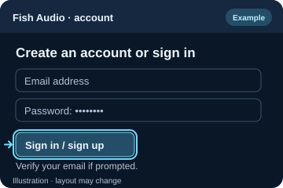

*Start with your Fish Audio account.*

### 2. Create and copy an API key

On API Keys, choose Create New Key and give it a name such as Choir. Set an expiration only if you want one. Copy the new key and keep it private.

[Open API Keys](https://fish.audio/app/api-keys)

[Official API key instructions](https://docs.fish.audio/developer-guide/getting-started/api-key)

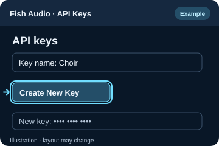

*Create a named API key and copy it securely.*

### 3. Create the Lumiverse TTS connection

Open Lumiverse Connect → TTS → New TTS Connection. Give it a name, select Fish Audio, and paste the key into API Key. Leave API URL empty, choose an available Model, and click Create. Existing connections use Save.

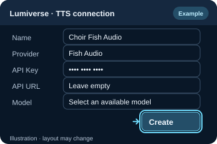

*Store the API key in the Lumiverse connection.*

### 4. Select the saved connection in Choir

Return to the Choir setup wizard. Click Refresh connections, then choose your saved Fish Audio connection under Default TTS connection.

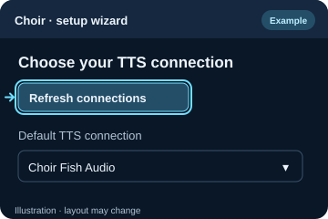

*Refresh after creating or changing a connection.*

### 5. Choose a voice, or copy its voice ID

In TTS & Voices, choose a Narrator voice. For a voice missing from the list, open its Fish Audio voice page and copy its voice ID from the page URL or copy button. In Choir, expand Use a provider voice ID and paste it into Narrator voice ID. A voice ID is different from an API key.

[Browse Fish Audio voices](https://fish.audio/)

[Official voice ID instructions](https://docs.fish.audio/developer-guide/getting-started/quickstart)

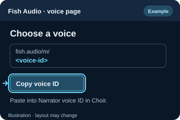

*API Key identifies your account; Voice identifies the voice.*

### 6. Test the narrator before finishing

In TTS & Voices, select your narrator voice and click Test narrator voice. Listen to the result. When it works, continue to Review and Finish setup. If Fish reports insufficient credits or access, check API billing and the selected model’s availability.

[Fish API billing](https://fish.audio/app/billing/)

[Current Fish API capabilities](https://docs.fish.audio/overview/capabilities)

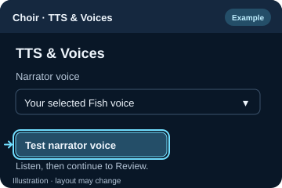

*A successful preview confirms that the connection and voice work together.*

### Troubleshooting

- Invalid or missing API key: update API Key in the Lumiverse connection, save it, then refresh Choir’s connections.
- Insufficient credits or access: check Fish API billing and model availability. Available free and paid API options can change; a paid web subscription is not a required setup step here.
- Unavailable voice or reference ID: verify the voice ID on its Fish Audio page and choose a voice your account can use. Never paste an API key into Voice.
- A rate-limit error needs a short wait before retrying. Repeated retries can make it last longer.

### Official sources

- [Fish Audio: Get Your API Key](https://docs.fish.audio/developer-guide/getting-started/api-key)
- [Fish Audio: Quick Start and voice IDs](https://docs.fish.audio/developer-guide/getting-started/quickstart)
- [Fish Audio: Current API capabilities](https://docs.fish.audio/overview/capabilities)

## How to get a Freesound API key

Get a Freesound API key, paste it into Optional Features, then enable the sound features and choose the LLM that selects sound cues.

### 1. Sign in to Freesound

Sign in to Freesound or create an account. Verify your email if asked before requesting API credentials.

[Open Freesound](https://freesound.org/)

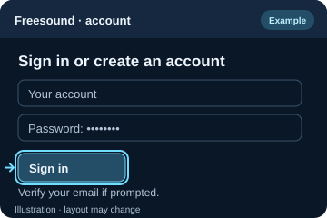

*Use your Freesound account to request API credentials.*

### 2. Request API credentials

Open the API credentials page and complete the application form shown there. Use a name such as Choir and describe your intended sound-effects and ambience use.

[Open Freesound API credentials](https://freesound.org/apiv2/apply/)

[Official API authentication help](https://freesound.org/docs/api/authentication.html#token-authentication)

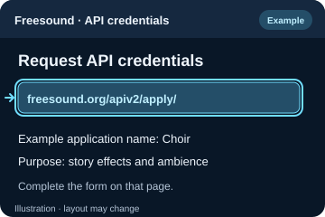

*Request credentials for the application you will use.*

### 3. Copy Client secret/Api key

In your API credentials, copy the value under Client secret/Api key. Do not copy Client ID: it is a different value and will not authenticate Choir’s sound searches.

[Open your API credentials](https://freesound.org/apiv2/apply/)

[Official token authentication instructions](https://freesound.org/docs/api/authentication.html#token-authentication)

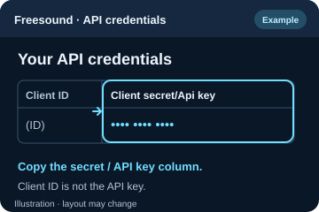

*Copy the secret/API key column, not Client ID.*

### 4. Paste the key into Choir

In the Choir setup wizard, open Optional Features. Paste the copied secret into Freesound API key. Keep the key private; the field hides it while you type.

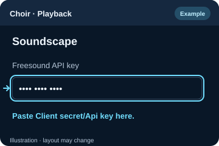

*Paste the Freesound key into Choir’s dedicated field.*

### 5. Enable sounds and choose the cue LLM

Enable Sound effects and/or Ambient sound. Select a working Sound cue LLM connection so Choir can choose relevant sounds for the story. You can leave these features off if you do not want sounds.

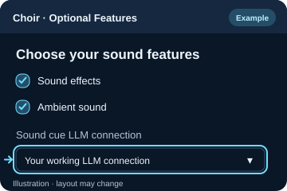

*The Freesound key finds audio; the cue LLM chooses when to use it.*

### 6. Finish setup and try Plan & Play

Continue to Review and click Finish setup to save your choices. In Choir’s Plan & Play section, use Plan latest on a story with a sound or ambience cue, then Play in the voice mixer to check the result.

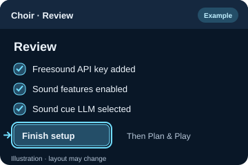

*Finish setup saves the choices for your sound test.*

### Troubleshooting

- Authentication fails: confirm you copied Client secret/Api key, not Client ID, and removed any surrounding spaces.
- No effects or ambience: check the relevant feature toggle and Sound cue LLM connection, then try a story with a clear sound cue. A cue can have no suitable search result.
- For Choir’s sound search and previews, use the API key. You do not need to set up an OAuth authorization flow.
- You can finish setup without Freesound and add the key later. Leave sound effects and ambience off until you want to use them.

### Official sources

- [Freesound: API credentials](https://freesound.org/apiv2/apply/)
- [Freesound: Token authentication](https://freesound.org/docs/api/authentication.html#token-authentication)
